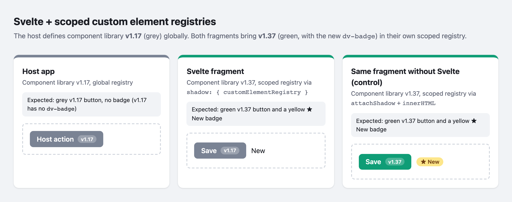
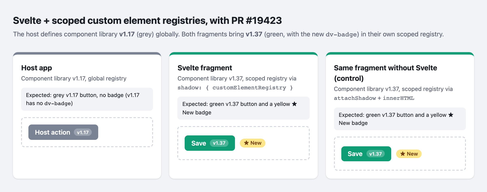

# Svelte + scoped custom element registries

Reproduction for scoped custom element registries in Svelte custom elements, used to test [sveltejs/svelte#19423](https://github.com/sveltejs/svelte/pull/19423).

On Svelte 5.59.1, elements that Svelte renders into a shadow root with a scoped registry use the global registry instead. PR #19423 fixes that.

**Svelte 5.59.1:** the Svelte fragment shows the host's grey v1.17 button and plain "New" text.



**Svelte with PR #19423:** the Svelte fragment shows its own green v1.37 button and the badge, like the control.



## Run it

```bash
npm install
npm run dev
```

Needs a browser with scoped custom element registries: Chrome 146+, Safari 26+ or Firefox 159+.

Versions: Svelte 5.59.1, Vite 8.3.8, Lit 3.3.3.

To try PR #19423, install its preview build (commit `5ca2ffd`) and run the dev server again:

```bash
npm install https://pkg.svelte.dev/svelte/c/5ca2ffd1ba4a1cc71b3c2db000cc08b4eaca0138
```

## What the page shows

A host app and two "fragments", which are independently built pieces of UI that the host embeds as custom elements. All of them use a small Lit-based component library, in different versions:

| Card                         | Component library                               | Registry                                                                                          |
| ---------------------------- | ----------------------------------------------- | ------------------------------------------------------------------------------------------------- |
| Host app                     | v1.17: grey `dv-button`                         | global `customElements`                                                                           |
| Svelte fragment              | v1.37: green `dv-button` and the new `dv-badge` | scoped, through `shadow: { mode: 'open', customElementRegistry: registry }` in `<svelte:options>` |
| Same fragment without Svelte | v1.37: green `dv-button` and the new `dv-badge` | scoped, through `attachShadow({ mode: 'open', customElementRegistry: registry })` and `innerHTML` |

**Expected:** both fragments show the green v1.37 button and the yellow ★ New badge.

**On Svelte 5.59.1:** the Svelte fragment's shadow root has the scoped registry, but the `dv-button` and `dv-badge` that Svelte renders into it use the global registry. So the fragment shows the host's grey v1.17 button. `dv-badge` doesn't exist in v1.17, so it isn't upgraded and stays plain text. The fragment without Svelte works as expected.

**With PR #19423:** the Svelte fragment shows the green v1.37 button and the badge, like the fragment without Svelte.

## Files

| File                           | What it is                                                                                                         |
| ------------------------------ | ------------------------------------------------------------------------------------------------------------------ |
| `src/fragment/Fragment.svelte` | The Svelte fragment, a custom element with a scoped registry                                                       |
| `src/fragment/registry.js`     | The fragment's scoped registry with component library v1.37                                                        |
| `src/vanilla-fragment.js`      | The same fragment without Svelte, as a control                                                                     |
| `src/App.svelte`               | The host app: defines component library v1.17 globally and renders the three cards                                 |
| `src/component-lib.js`         | Stand-in for the component library. Each call defines fresh classes, like a separately bundled copy of one version |
| `src/main.js`                  | Mounts `App.svelte`                                                                                                |

## Things to try

- Remove `defineComponentLib(customElements, '1.17')` from `src/App.svelte`. The Svelte fragment then shows plain text only, because nothing in the global registry upgrades its elements.
- Render the elements in `Fragment.svelte` inside `{#if}`, `{#each}`, `<svelte:element>` or `{@html}`. They use the global registry too.
